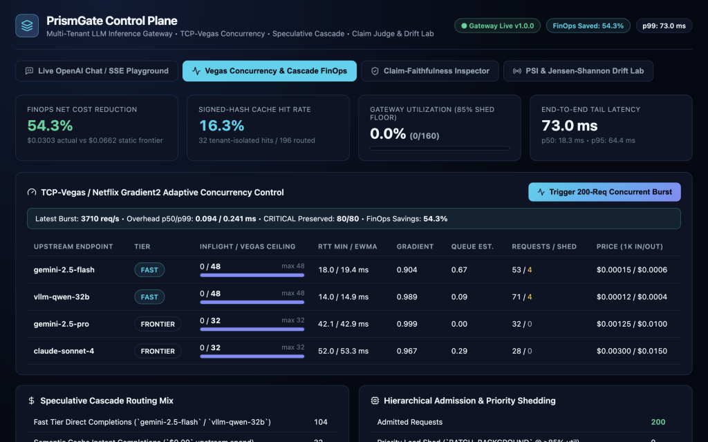
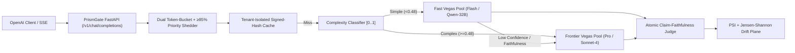

# PrismGate

[](https://github.com/nagarjunak-pixel/prism-gate/actions/workflows/ci.yml)
[](https://github.com/nagarjunak-pixel/prism-gate/releases/tag/v1.0.0)
[](https://www.python.org/)
[](https://www.typescriptlang.org/)
[](#verification--quality-gates)
[](LICENSE)

**PrismGate** is an OpenAI-compatible, multi-tenant **LLM gateway prototype** written in Python. It combines an adaptive concurrency limiter based on TCP Vegas / Netflix Gradient2 ideas, per-tenant token-bucket admission with priority shedding, a heuristic complexity-based cascade router with a feature-hashing response cache, a rule-based claim-faithfulness checker, and **Population Stability Index (`PSI`)** / **Base-2 Jensen-Shannon Divergence (`JSD`)** drift detectors.

It is a reference implementation for exploring these control-plane techniques, not a production gateway. The bundled benchmark runs against a simulated upstream pool (synthetic latencies and a static price table for `gemini-2.5-flash`, `vllm-qwen-32b`, `gemini-2.5-pro`, `claude-sonnet-4`); in that simulation, cascade routing plus caching reduced modeled spend by **57.16%** versus pinning every request to `claude-sonnet-4`. An HTTP adapter can proxy a real OpenAI-compatible endpoint, but it has not been benchmarked here.

---

## Live PrismGate Multi-Tenant Control Plane (TCP-Vegas, FinOps Cascade & Drift Lab)



---

## Core Architecture



### Five Production Control-Plane Subsystems

1. **TCP-Vegas / Netflix Gradient2 Adaptive Concurrency (`src/prism_gate/concur/vegas_limiter.py`)**:
   - Continuously estimates upstream standing queue depth $\hat{Q} = \text{inflight} \times (1 - \text{RTT}_{\min} / \text{RTT}_{\text{sample}})$.
   - Expands `max_inflight` additively when $\text{RTT}_{\text{sample}}$ tracks $\text{RTT}_{\min}$, holds steady inside the Little's Law equilibrium band, and backs off multiplicatively on standing queue buildup or HTTP `429`/`503` throttling—with non-blocking sibling failover across same-tier providers.
2. **Hierarchical Multi-Tenant Admission & Priority Load Shedding (`src/prism_gate/admission/token_bucket.py`)**:
   - Atomic per-tenant dual token buckets (**Requests-Per-Second** + **Tokens-Per-Minute**) with post-completion token reconciliation.
   - Progressive gateway load shedding above **85% utilization**: sheds `BATCH_BACKGROUND` at $\ge 85\%$ and `INTERACTIVE` at $\ge 95\%$, preserving emergency capacity for `CRITICAL` tier SLOs without burning shed tenants' own RPS/TPM budgets.
3. **Speculative Complexity Cascade Router & Signed-Hash Semantic Cache (`src/prism_gate/routing/cascade_router.py`)**:
   - Sub-50µs structural complexity scorer evaluating reasoning depth, code/math density, constraint density, and multi-hop markers.
   - **Tenant-Isolated Signed Feature-Hashing Cache** ($D = 256$ Weinberger random projections + numeric & negation parity guards) ensuring zero cross-tenant or cross-RAG-context leakage.
   - Honest FinOps ledger tracking exact actual spend (including dual fast+frontier charges on cascade escalations) against counterfactual static frontier pinning.
4. **Online Claim-Level Groundedness / Hallucination Judge (`src/prism_gate/evals/faithfulness.py`)**:
   - Decomposes completions into atomic claims and verifies canonicalized currency/dosage/percentage literals (`$12.4M` vs `$18.9M`, `5mg` vs `500mg`), domain entities, and clinical/financial antonym polarity against retrieved RAG context chunks.
   - Prevents hallucinated completions from poisoning the semantic cache.
5. **Statistical Distribution-Shift Plane (`src/prism_gate/drift/detectors.py`)**:
   - **Population Stability Index (`PSI`)** across decile-binned prompt length, complexity, and latency distributions.
   - **Base-2 Jensen-Shannon Divergence (`JSD` $\in [0, 1]$ bits)** over token and topic distributions, formally verified via `Hypothesis` for exact identity ($\text{JSD}(P,P)=0$), bit-for-bit symmetry ($\text{JSD}(P,Q)=\text{JSD}(Q,P)$), and unit-interval boundedness.

---

## Measured Benchmark Performance

Executed locally on Apple Silicon (Python 3.12.12, `uv run prism benchmark --requests 300 --concurrency 32` with mid-run upstream congestion injection):

| Metric | Measured Value | Notes |
| :--- | ---: | :--- |
| **Gateway Control-Plane Overhead (`p50 / p95 / p99`)** | **`0.067 / 0.126 / 0.137 ms`** | Admission + Complexity + Signed-Hash Cache + Vegas Lease |
| **End-to-End Inference Latency (`p50 / p95 / p99`)** | **`15.90 / 62.15 / 72.02 ms`** | Mixed Fast, Cache Hit, Escalated, and Frontier traffic |
| **Sustained Gateway Throughput** | **`4,666.6 req/s`** | `300` requests @ `32` concurrent async workers |
| **FinOps Net Inference Cost Reduction** | **`57.16%`** | `$0.040807` actual vs `$0.095247` static `claude-sonnet-4` pin |
| **Tenant-Isolated Semantic Cache Hit Rate** | **`17.5%`** | Zero cross-tenant leakage; numeric/negation guarded |
| **`CRITICAL` Priority Tier Preservation** | **`97.5%` (`117 / 120`)** | Protected by progressive `BATCH_BACKGROUND` shedding at $\ge 85\%$ util |

---

## Scope & Limitations

- **Scale:** ~4.5k lines of Python in `src/prism_gate` (plus ~1.3k lines of tests) and a ~1.4k-line React/TypeScript demo UI. Single-process, in-memory state (token buckets, limiters, cache); no persistence, distributed coordination, or hardened auth.
- **Benchmarks are simulated:** the numbers above come from `prism benchmark` against `SimulatedUpstreamPool` (synthesized completions, simulated RTTs with injected congestion, static per-model prices) on 300 requests built from a small set of hand-written prompts, run on one Apple Silicon laptop (CPU only). Throughput and latency reflect gateway overhead plus scaled simulated sleeps, not real model serving; the cost reduction is a modeled figure.
- **Heuristic components:** the complexity scorer uses lexical/structural features; the "semantic" cache uses signed feature hashing of words and bigrams (lexical similarity, no embedding model); the faithfulness judge is a regex/lexical rule checker (numbers, units, entities, antonyms), not an NLI or LLM judge.
- **Verification:** JSD/PSI properties (identity, symmetry, boundedness) are checked with `Hypothesis` property-based tests, which is testing rather than formal proof.
- **Not production-hardened:** the gateway has not been load-tested against real providers or deployed in production; treat it as an educational reference.

---

## Quickstart

### 1. Install & Run Interactive Control-Plane Showcase

```bash
uv sync --python 3.12 --all-extras

# Run interactive routing, Vegas adaptation, RAG hallucination judge & drift demo
uv run prism demo

# Verify PSI & Jensen-Shannon mathematical invariants across traffic regimes
uv run prism drift-check

# Run 300-request concurrent load & FinOps benchmark
uv run prism benchmark --requests 300 --concurrency 32
```

### 2. Build the Dark-Mode Observability UI & Launch the Gateway

```bash
cd ui && npm install && npm run build && cd ..
uv run prism serve --host 127.0.0.1 --port 8000
```

Open `http://127.0.0.1:8000` to explore the 4-tab **PrismGate Control Plane Console**:
- **Live OpenAI Chat / SSE Playground** (`text/event-stream` token streaming + live `prism_meta` FinOps & complexity breakdown)
- **Vegas Concurrency & Cascade FinOps Telemetry** (dynamic `inflight / max_inflight` ceilings, RTT gradients, and one-click 200-request load burst)
- **Claim-Faithfulness Hallucination Inspector** (atomic claim verification for clinical & financial RAG)
- **PSI & Jensen-Shannon Drift Lab** (interactive decile histograms & `NO_DRIFT` / `MODERATE_DRIFT` / `CRITICAL_DRIFT` simulator)

### 3. Drop-In OpenAI REST & SSE Streaming Usage

```bash
curl -N http://127.0.0.1:8000/v1/chat/completions \
  -H "Content-Type: application/json" \
  -d '{
    "model": "prism-auto",
    "stream": true,
    "tenant_id": "tenant-enterprise-01",
    "priority": "CRITICAL",
    "messages": [
      {"role": "user", "content": "Summarize Q3 revenue and GAAP operating margin."}
    ],
    "rag_context": [
      "Acme Corp reported Q3 2025 revenue of $12.4M with GAAP operating margin of 18.5%."
    ]
  }'
```

Prometheus scrape endpoint is exposed natively at `GET /metrics` (`text/plain; version=0.0.4`). To proxy live external OpenAI-compatible upstreams (`vLLM`, `SGLang`, OpenAI, Gemini), set `PRISM_UPSTREAM_BASE_URL` and `PRISM_UPSTREAM_API_KEY`.

---

## Documentation & Architecture Decision Records

- [System Architecture & Request Lifecycle](docs/architecture.md)
- [Mathematical Foundations (Vegas, Signed Hashing, PSI & Base-2 JSD)](docs/mathematical-foundations.md)
- [ADR 0001 — TCP-Vegas & Netflix Gradient2 Concurrency Control](docs/adr/0001-tcp-vegas-gradient-concurrency-control.md)
- [ADR 0002 — Speculative Complexity Cascade Routing & Semantic Cache](docs/adr/0002-speculative-complexity-cascade-routing.md)
- [ADR 0003 — Dual PSI & Base-2 Jensen-Shannon Drift Detection](docs/adr/0003-jensen-shannon-and-psi-drift-detection.md)
- [ADR 0004 — Online Atomic Claim-Faithfulness Verification](docs/adr/0004-atomic-claim-faithfulness-verification.md)

---

## Verification & Quality Gates

```bash
uv run ruff check src tests
uv run ruff format --check src tests
uv run mypy src
uv run pytest --cov=prism_gate --cov-fail-under=95 --cov-report=term-missing
cd ui && npm ci && npm run build
```

---

## Enterprise AI Reference Suite Integration

PrismGate serves as **Pillar 3 (High-Throughput Inference Control Plane, Faithfulness & Statistical Drift)** in a cohesive 3-system enterprise AI architecture:
1. **[`aegis-runtime`](https://github.com/nagarjunak-pixel/aegis-runtime)** — Zero-Trust Agentic Control Plane, `.aegis` AST Policy Compiler, & Cryptographic ERP Saga Engine.
2. **[`chronos-mesh`](https://github.com/nagarjunak-pixel/chronos-mesh)** — Multi-Echelon Supply-Chain Digital Twin, Exact Branch-and-Bound MILP Solver, & `CVaR95` Risk Engine.
3. **[`prism-gate`](https://github.com/nagarjunak-pixel/prism-gate)** — OpenAI-Compatible Streaming Gateway, TCP-Vegas Concurrency Controller, Speculative Cascade Router, & `PSI`/`JSD` Drift Plane.

---

## Author & License

Created and maintained by **Nagarjuna Kamireddy** (`sendemailtonagarjuna@gmail.com`).  
Licensed under the [Apache License, Version 2.0](LICENSE).

---

## Author & Enterprise AI Architecture Hub
Built by **[Nagarjuna Reddy Kamireddy](https://nagarjunak-pixel.github.io/)** (*Nagarjuna Kamireddy / Nagarjuna K*) — Lead AI Architect, GenAI & Agentic AI Lead, and Corporate AI Trainer (20+ years across Enterprise Data, SAP HANA & Production AI; AWS Certified Solutions Architect – Professional & NVIDIA-Certified Professional: Agentic AI).

- **Official Portfolio & Architecture Hub:** [https://nagarjunak-pixel.github.io/](https://nagarjunak-pixel.github.io/)
- **Enterprise Case Studies & Technical Articles:** [Case Studies](https://nagarjunak-pixel.github.io/case-studies.html) · [Architecture Articles](https://nagarjunak-pixel.github.io/articles.html) · [10-Mandate Role Fit](https://nagarjunak-pixel.github.io/roles.html)
- **Master CV & AI Search Index:** [Master CV](https://nagarjunak-pixel.github.io/resume.html) · [`llms-full.txt`](https://nagarjunak-pixel.github.io/llms-full.txt) · [LinkedIn](https://www.linkedin.com/in/nagarjuna-kamireddy)
