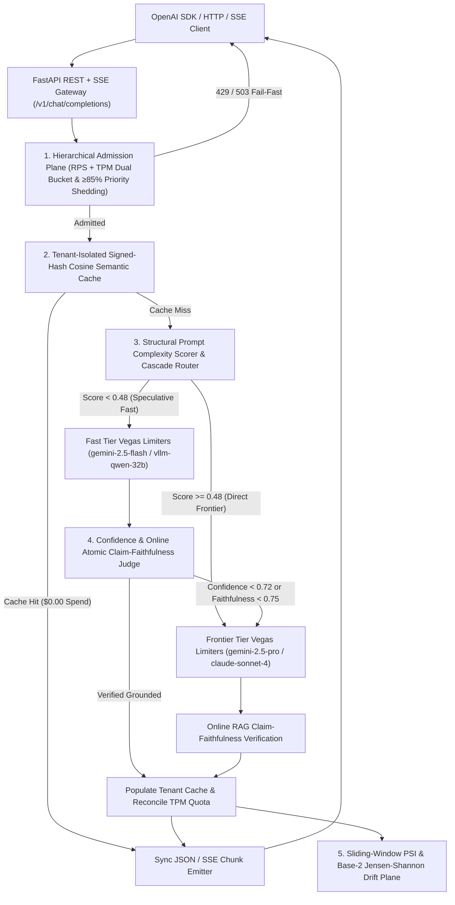

# PrismGate System Architecture

**PrismGate** separates multi-tenant LLM inference serving into a deterministic **Sub-150µs Control Plane** and an **OpenAI-Compatible Async Streaming Data Plane**, paired with an **Online Claim-Faithfulness Verifier** and a **Statistical Distribution-Shift Plane**.

## Request Lifecycle & Isolation Guarantees

1. **Progressive Priority Load Shedding (`src/prism_gate/admission/token_bucket.py`)**:
   - Before touching per-tenant token buckets, PrismGate inspects aggregate gateway utilization $u = \sum \text{inflight}_i / \sum \text{max\_inflight}_i$.
   - Crossing **85% utilization** sheds `BATCH_BACKGROUND` traffic (`HTTP 503`); crossing **95% utilization** sheds `INTERACTIVE` traffic while preserving emergency headroom exclusively for `CRITICAL` tier traffic.
   - Shedding at the global gateway tier never deducts from a tenant's own RPS or TPM bucket.
2. **Atomic Dual Token-Bucket Enforcement**:
   - Each tenant SLO profile maintains synchronized `RPS` and `TPM` buckets. Token deduction occurs atomically only if both buckets satisfy the pre-dispatch reservation; post-completion reconciliation refunds unused completion tokens.
3. **Tenant-Isolated Signed-Hash Semantic Cache (`src/prism_gate/routing/cascade_router.py`)**:
   - Partitions are keyed by `f"{tenant_id}::rag:{blake2b(rag_context)}"` so neither prompt embeddings nor completions ever cross tenant or RAG document boundaries.
   - Numeric literal signatures and negation parity guards prevent false-positive cache collisions on quantitative or negated queries (`Invoice #1042` vs `Invoice #9999`).
4. **TCP-Vegas / Gradient2 Adaptive Concurrency (`src/prism_gate/concur/vegas_limiter.py`)**:
   - Each upstream provider dynamically adjusts `max_inflight` from RTT gradients without manual static tuning. If the primary provider in a tier hits its Vegas ceiling, `_acquire_tier_lease` fails over non-blockingly to healthy sibling endpoints in the same tier.
5. **Online Atomic Claim-Faithfulness Judge (`src/prism_gate/evals/faithfulness.py`)**:
   - When `rag_context` chunks are supplied, completions are decomposed into atomic claims and checked for numeric/dosage/currency alignment, entity grounding, and antonym contradictions. Any completion with `hallucination_detected == True` is blocked from poisoning the semantic cache.
6. **SSE Streaming Integrity (`src/prism_gate/gateway/app.py`)**:
   - Admission, rate-limiting, and Vegas lease acquisition execute *prior* to sending `HTTP 200 text/event-stream` headers so `429` (`Retry-After`) and `503` backpressure codes remain standards-compliant for OpenAI SDK retry loops.
